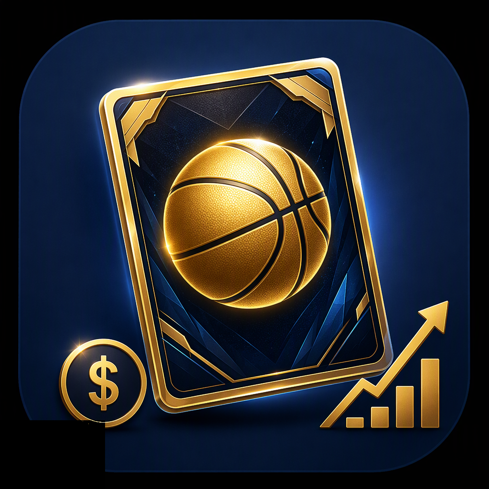
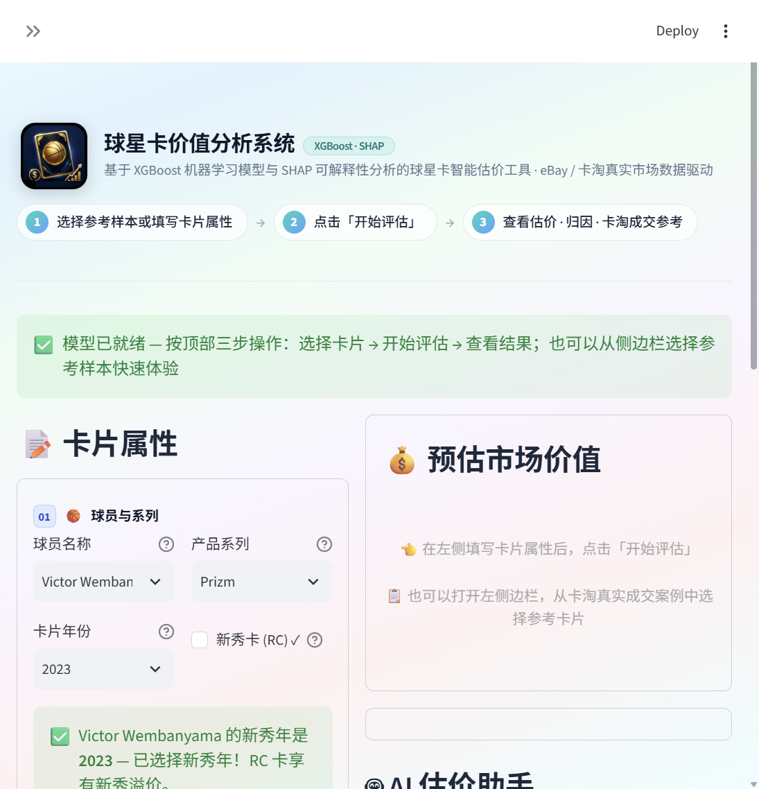

# 球星卡价值分析系统 (Star Card Analyzer)

<p align="center">
  
</p>

<p align="center">
  
  
  
  
  
</p>

基于 XGBoost 的球星卡定价系统：解析卡片特征（球员/系列/折射/签字/物料/评级），
结合 eBay / CardHobby（卡淘）真实市场数据训练定价模型，提供 Web 界面估价、
卡淘真实成交参考和 AI 智能助手。

## 界面预览

<p align="center">
  
</p>

## 功能亮点

- 🃏 **卡片估价**：填写卡片属性（球员/系列/年份/折射/签字/物料/评级），XGBoost + SHAP 给出预估价格、置信区间与特征归因
- 📊 **卡淘真实成交参考**：右侧展示卡淘（CardHobby）近期真实成交，可翻页浏览同价位能买到什么
- 🔄 **一键更新数据**：左侧边栏点击按钮即可在线采集最新成交数据并重训模型，全程进度可视、无需命令行
- 🔑 **API Key 快捷配置**：侧边栏可视化面板粘贴即生效，或一条 PowerShell 命令完成配置
- 🖥️ **桌面快捷启动**：双击桌面图标 / `scripts\start_app.bat` 一键打开应用
- 🤖 **AI 估价助手**：对话式评估卡片、识别冷门球员、查询卡淘成交（可选接入 OpenAI 兼容 LLM，如 DeepSeek）
- 🔌 **REST API**：`/evaluate` 估价、`/api/agent/chat` AI 助手对话，方便接入其他应用

## 使用流程

1. **选择卡片**：从左侧边栏选择卡淘真实成交参考样本一键填入，或手动填写卡片属性（球员 / 系列 / 年份 / 折射 / 编号 / 签字 / 物料 / 评级）
2. **开始评估**：点击「🔍 开始评估」，模型给出美元估价、置信区间与 SHAP 特征归因
3. **查看参考**：右侧对照卡淘人民币真实成交（≈×7.25 换算），AI 助手可进一步对话追问

## 快速开始（模型已内置，无需采集训练）

> 仓库已包含预训练模型（`models/`）与真实成交数据（`data/`），clone 下来即可直接估价。

```bash
# 1. 克隆项目
git clone https://github.com/Dioinnet/Star-Card-analyzer.git
cd Star-Card-analyzer

# 2. 一键安装（Windows 双击 scripts\install.bat；macOS/Linux 执行 bash scripts/install.sh）
#    等价于手动三步：
python -m venv venv
venv\Scripts\python -m pip install -r requirements.txt   # macOS/Linux: venv/bin/python
venv\Scripts\python -m playwright install chromium       # 仅采集数据需要，估价可跳过

# 3. 启动 Web 界面
streamlit run app.py
```

浏览器打开 **http://localhost:8501** 即可使用。

### 桌面快捷启动（Windows）

双击 `scripts\start_app.bat` 即可启动；建议在桌面创建快捷方式（右键该文件 → 发送到 → 桌面快捷方式），
并将快捷方式图标替换为 `assets\app_icon.ico`，日常使用双击即开。

### 更新数据（界面内一键完成）

打开左侧边栏的「🔄 更新数据（采集 + 重训）」面板，点击「🚀 开始更新数据」即可在线采集
卡淘 / eBay 最新成交并重训模型，全程进度可视、无需命令行。命令行方式见下文「可选：更新数据与重训模型」。

## 启用 AI 估价助手（可选，需自备 LLM API Key）

不配置也可使用——助手自动降级为配置引导模式。

**快捷配置（二选一）**：

- 界面：启动应用 → 左侧边栏「🔑 AI 助手 API Key」→ 选服务商、粘贴 Key → 保存即生效（无需重启）
- PowerShell：运行 `powershell -File scripts\set_api_key.ps1`，按提示粘贴 Key（或直接带 `-Key` 参数）

传统方式（手动编辑 `agent.env`）：

```bash
# 复制配置模板（Windows: copy agent.env.example agent.env）
cp agent.env.example agent.env
# 编辑 agent.env，取消注释并填入你的 LLM API Key，重启应用生效
```

支持任何 **OpenAI 兼容接口**（DeepSeek / 通义千问 / Kimi / 智谱 GLM / OpenAI 官方）：

| 配置项 | 必填 | 默认值 | 说明 |
|--------|------|--------|------|
| `OPENAI_API_KEY` | 是 | - | LLM 服务密钥 |
| `OPENAI_BASE_URL` | 否 | `https://api.deepseek.com` | 接口地址，注意服务商文档是否要带 `/v1` |
| `AGENT_MODEL` | 否 | `deepseek-chat` | 模型名 |

也可以用环境变量（优先于 agent.env）：`$env:OPENAI_API_KEY = "sk-..."`（PowerShell）或 `export OPENAI_API_KEY=sk-...`（bash）。

> 币种说明：模型估价为美元（USD），卡淘成交参考为人民币（CNY，≈×7.25），助手回答时会分别注明。

## 可选：更新数据与重训模型

预训练模型可直接使用；想跟上最新市场行情可自行采集并重训。

### 数据采集

```bash
python scripts\build_comps_db.py --players 15     # 采集 15 名顶级球星（默认）
python scripts\build_comps_db.py --skip-ebay      # 仅 CardHobby（国内网络推荐）
python scripts\build_comps_db.py --ebay-pages 2 --cardhobby-pages 30
python scripts\build_comps_db.py --ebay-login     # 登录 eBay 解锁已售出数据（可选）
```

输出：`data/ebay_comps_database.csv`（USD）、`data/cardhobby_comps_database.csv`（CNY）。

### 训练模型

```bash
python train.py
```

### 平台说明

- **CardHobby（卡淘）**：公开数据源 `/market/auction`（在拍）、`/market/timeout`（即将结束），
  仅保留**有出价（bids>0）**的记录作为真实价格信号
- **eBay**：网页端部署 Akamai 反爬（普通 requests 直接 403），采集器内置三层降级链
  `requests → curl_cffi → playwright(有头浏览器)`；中国区 IP 下已售出过滤会触发登录墙，
  自动降级为常规搜索（在售价格）；如需已售出数据可先跑 `--ebay-login` 保存登录态
- 国内网络建议以卡淘采集为主（`--skip-ebay`），eBay 按需手动更新

## REST API

```bash
# 启动 API 服务
uvicorn src.api.main:app --host 0.0.0.0 --port 8000
```

| 方法 | 路径 | 说明 |
|------|------|------|
| GET | `/health` | 健康检查（模型是否就绪） |
| POST | `/evaluate` | 卡片估价（18 字段：球员/系列/年份/折射/限量/签字/物料/评级等） |
| POST | `/api/agent/chat` | AI 助手对话（OpenAI 兼容消息格式，带工具调用；未配置 LLM Key 时降级返回） |

## 技术栈

- **模型**：XGBoost 回归（定价）+ SHAP（特征归因）
- **界面**：Streamlit（自定义琉璃渐变 + 玻璃态设计系统）
- **数据**：CardHobby 卡淘 / eBay 真实成交采集（Playwright + curl_cffi 降级链）
- **API**：FastAPI + Uvicorn
- **AI 助手**：OpenAI 兼容接口 + function calling（球员识别 / 卡淘参考查询）

## 运行测试

```bash
python scripts\verify_bouknight_form.py    # 表单填入 + 估价回归（需预训练模型）
python scripts\verify_cardhobby_only.py    # 展示层只留卡淘 + 聊天面板降级
python scripts\verify_agent_api.py         # /api/agent/chat 接口行为
python scripts\verify_ai_lookup.py         # AI 联网识别球员（需网络）
```

> 测试环境请勿配置 OPENAI_API_KEY（验证脚本默认走降级路径，避免真实调用 LLM）。

## 目录结构

```
app.py                            # Streamlit 界面（品牌头部 + 估价表单 + 结果 + AI 助手）
train.py                          # 端到端训练脚本
assets/                           # 应用图标（app_icon.png / app_icon.ico）
docs/                             # 界面预览截图
scripts/build_comps_db.py         # 真实数据采集脚本（标题→特征解析）
scripts/update_all.py             # 一键数据更新 + 模型重训
scripts/set_api_key.ps1           # API Key 快捷配置（PowerShell）
scripts/start_app.bat             # Windows 一键启动
scripts/install.bat / install.sh  # 一键安装（跨平台）
src/scrapers/                     # 采集器（ebay 三层降级 / cardhobby）
src/scrapers/data_pipeline.py     # 数据清洗管线（标题解析/去重/异常值）
src/features/card_encoder.py      # 特征编码器
src/models/pricing_engine.py      # XGBoost 定价引擎（含 SHAP 归因）
src/services/pricing_service.py   # 评估逻辑唯一事实源（API / Agent / 界面复用）
src/assistant/                    # AI 助手（球员识别 + 卡淘参考 + LLM agent）
src/api/main.py                   # FastAPI：/health /evaluate /api/agent/chat
data/                             # 成交数据库（CSV，含预训练用真实数据）
models/                           # 预训练模型（joblib）
agent.env.example                 # LLM 配置模板（复制为 agent.env 后填写）
```

## 免责声明

采集模块仅供学习研究。eBay 用户协议禁止未经授权的自动抓取，请控制请求频率；
生产环境请考虑 eBay 官方 API 或数据服务商。估价结果仅供娱乐参考，不构成投资建议。

## License

[MIT](LICENSE)
